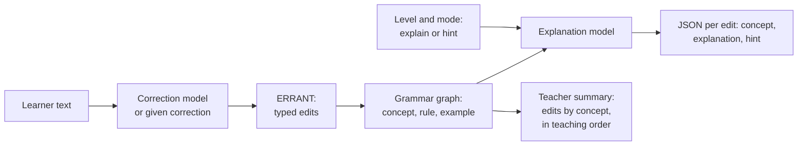

# Explain-to-Learn

[](https://github.com/m-555/explain-to-learn/actions/workflows/ci.yml)
[](https://github.com/m-555/explain-to-learn/actions/workflows/smoke.yml)
[](LICENSE)

Turns grammar corrections in English learners' writing into short explanations or hints matched to the learner's CEFR level, grounded in a teacher-built grammar graph.

> **Status: in development.** The pipeline, training and evaluation code is in place; the experiments have not been run yet, so there are no results. See the [roadmap](#roadmap).

A B1 learner writes *"She don't like to going."* The system finds two edits, labels them (subject-verb agreement; base form after *to*) and returns one short explanation per edit. It can also return a hint instead of the answer, for example "Check the verb after *she*." A summary for the teacher groups a text's errors by grammar concept in a suggested teaching order.

**Research question:** does grounding a small fine-tuned model in a teacher-built grammar graph make its explanations more correct, and better matched to learner level, than prompting alone?

## Demo

A public demo on Hugging Face Spaces arrives with v1.0; [demo/README.md](demo/README.md) shows how to run it locally.

## Results

Not available yet.

## How it works



1. **Correction.** Training and the main evaluation use the corpus's gold corrections, so explanation quality is measured separately from correction quality. For free text, a small open correction model ([Unbabel/gec-t5_small](https://huggingface.co/Unbabel/gec-t5_small)) or the explanation model prompted to correct supplies the correction, or the user gives it.
2. **Edits.** [ERRANT](https://github.com/chrisjbryant/errant) aligns each sentence with its correction and splits the change into typed edits such as `R:VERB:SVA`, in the same format as the gold edit table.
3. **Grounding.** Each ERRANT error type maps to a concept in the grammar graph, which gives the rule worded for the learner's level, an example and the concept's prerequisites.
4. **Explanation.** A small open-weight instruction model (Qwen3-4B-Instruct-2507), fine-tuned with LoRA, takes the sentence, the edit, its error type, the graph snippet, the learner level and the mode. It returns JSON with the concept, a one- or two-sentence explanation and a hint.
5. **Teacher summary.** Without any model, the edits of a text are grouped by concept with their positions, and the concepts are ordered so that each comes after the concepts it builds on that also have errors.

The same code runs the evaluation, the `explain-to-learn` command and the demo (`src/explain_to_learn/pipeline.py`).

### Systems compared

| System | Model | Graph grounding | What it tests |
| --- | --- | --- | --- |
| A | Base model, prompted | No | Baseline |
| B | Base model, prompted | Yes | Effect of grounding alone |
| C | LoRA-tuned | No | Effect of fine-tuning alone |
| D | LoRA-tuned | Yes | Full system |
| R | Larger teacher model (gpt-oss-20b), prompted | Yes | Reference point; also writes the silver training data |

Models, adapters and server addresses are set in [configs/systems.yaml](configs/systems.yaml).

## Quick start

Requires Python 3.11 or newer. Install the package with the extras for the grammar graph, generation and the demo:

```bash
python -m venv .venv && source .venv/bin/activate
pip install -e ".[dev,graph,generate,demo]"
```

To install every extra except the GPU stack (adding ERRANT and the report tools), use `pip install -r requirements.txt` instead. `requirements-gpu.txt` sets up the training environment on the GPU in one step.

Download the corpora into `data/raw/` (git-ignored). The script prints the licence terms and only downloads with the flag:

```bash
bash scripts/download_data.sh --accept-licence
```

Build the edit table, the essay split files, the gold edit IDs and the data statistics. This needs only the standard library, and the edit IDs match `data/splits/gold_edit_ids.txt`:

```bash
python -m explain_to_learn.edits build --raw data/raw --out data/processed/edits.jsonl
python -m explain_to_learn.splits --edits data/processed/edits.jsonl --out data/splits
python scripts/data_stats.py --edits data/processed/edits.jsonl --out eval/results/data_stats.md
```

Run the demo in preview mode, with rule-based stubs instead of models, and open <http://localhost:7860>:

```bash
python demo/app.py --fake
```

Run the linter and tests:

```bash
ruff check . && pytest
```

With the models installed (`pip install -e ".[data,model]"`, PyTorch and `python -m spacy download en_core_web_sm`), the `explain-to-learn` command gives feedback on a text and summarises a text for a teacher:

```bash
explain-to-learn explain "She don't like to going to school." --level A2 --mode hint
explain-to-learn summary essay.txt --level B1
```

GPU work (generation, training, evaluation) runs on an RTX 5090 in WSL2 or Docker. [docs/experiments.md](docs/experiments.md) is the complete runbook, from the environment to the release; [docs/gpu_setup.md](docs/gpu_setup.md) covers the Blackwell (`sm_120`) setup, which needs PyTorch 2.14.1 built for CUDA 13.0 (`cu130`). Other extras: `data` (ERRANT and spaCy), `model`, `train` and `analysis` (report figures and notebooks).

## The grammar graph

The graph in [grammar_graph/](grammar_graph/) holds the teaching knowledge that grounds every explanation:

- `concepts.yaml`: about 50 grammar concepts. Each has a rule worded for three bands (A2, B1, B2), one invented example with its correction, its prerequisite concepts and the grammar terms a learner at each band can be expected to know.
- `errant_map.yaml`: the concept for every ERRANT error category, with overrides where the operation changes what the learner needs to know (an unnecessary article is a different lesson from a wrong one).

The prerequisite links form a directed acyclic graph, so the teacher summary can order concepts. To add or change a concept, edit the YAML files and run `python -m explain_to_learn.graph validate`, which reports duplicate IDs, unknown prerequisites, cycles, unmapped error categories and missing content. [grammar_graph/README.md](grammar_graph/README.md) describes the formats and the steps. The content is a draft: three concepts are complete examples, and the rest are written and reviewed by a teacher before the experiments.

## Evaluation protocol

- **Data.** Edits come from the BEA-2019 releases of W&I+LOCNESS (main source, with CEFR levels) and FCE (extra training edits). Splits follow the official ones, which are by essay. The gold set is 300 W&I+LOCNESS dev edits, stratified by error category and level ([data/splits/](data/splits/), [DATA_CARD.md](DATA_CARD.md)). Learner text is not stored in this repository: it holds scripts and edit IDs, so the data can be rebuilt after downloading the corpora under their own licences.
- **Training data.** The teacher model writes silver explanations and hints for training edits; outputs are kept only if they parse, name the graph concept and name the edited words, and a teacher checks 200 kept items.
- **Automatic metrics** on the 300 gold edits: coverage, concept accuracy, faithfulness (names the edited words; a hint must not give the answer) and level fit (length and grammar terms above the learner's level), per system, CEFR level and error category.
- **Blind teacher ratings** on 400 items (100 edits × systems A to D, shuffled, system names hidden) with the rubric in [eval/rubric.md](eval/rubric.md), adapted from the BEA 2025 shared task: rule correct, error located, helps the learner fix it, fits the level, and a flag for invented rules.
- **Agreement.** A second teacher rates 50 items (Cohen's kappa), and an LLM judge using the same rubric is checked against the human ratings.
- **Analysis.** Paired bootstrap confidence intervals for B−A, C−A, D−B and D−C, broken down by error type and learner level.
- **Correction.** For the end-to-end pipeline, the correction step is scored separately with ERRANT (span-based F0.5) on the W&I+LOCNESS dev set, overall and per level.

Only aggregate results are published, in [eval/results/](eval/results/). [docs/annotation_guide.md](docs/annotation_guide.md) describes the local annotation app used for the gold explanations, the ratings and the silver hand-check, and [docs/design_decisions.md](docs/design_decisions.md) explains the reasons behind these choices.

## Limitations

- English only, on teen and adult exam-style writing, not children's writing.
- One main rater; agreement is measured on a subset only.
- Silver training data from a larger model may carry that model's errors and biases; the hand-check covers a sample.
- The main evaluation assumes gold corrections; in real use, correction errors carry through to the explanations.
- About 50 concepts; rare errors fall back to generic explanations.
- The teacher summary orders concepts by the graph's prerequisite links and error counts only; it does not know the learner's history.

## Roadmap

Code items are ticked when the code is done; experiments are ticked when they have been run and their results published.

- [x] Data pipeline: download script, edit table with essay IDs and levels, essay-level splits, data statistics
- [x] Grammar graph code: loader, ERRANT type mapping, prerequisite links, validation
- [ ] Grammar graph content: rules, examples and terms for every concept, reviewed by a teacher
- [x] Prompts, generation backends and automatic metrics
- [ ] Prompted baselines (A, B) run and scored
- [x] Silver-data generation, filtering and hand-check export
- [ ] Silver training explanations generated, filtered and hand-checked, with a data card
- [x] LoRA training code for C and D, with run logging and Hub upload
- [ ] LoRA fine-tuning (C, D) on a single 32 GB GPU, adapters on the Hugging Face Hub
- [x] Human evaluation code: blind rating sheets, agreement, LLM judge
- [ ] Gold-set evaluation: blind ratings, second rater, LLM judge
- [ ] Analysis: confidence intervals, per-error-type and per-level breakdowns
- [x] End-to-end pipeline: correction, ERRANT edits, explanations, teacher summary, command-line tool, correction F0.5 script
- [x] Gradio demo with a preview mode
- [ ] Demo on Hugging Face Spaces, model card, short report and v1.0 release

## Repository layout

```
├── configs/                   # systems.yaml (models, adapters, servers, correctors), grammar terms
├── grammar_graph/             # concepts.yaml, errant_map.yaml
├── src/explain_to_learn/      # io, edits, splits, graph, prompts, generate, metrics, silver,
│                              # train_data, preference, human_eval, gee, pipeline, summary, cli
│   └── annotation/            # local annotation app for the teacher's tasks
├── scripts/                   # data download, runs, metrics, silver data, ratings, agreement,
│                              # LLM judge, correction F0.5, GEE comparison, report assets,
│                              # showcase candidates, Space sync
├── train/                     # LoRA and DPO configurations and training scripts
├── eval/                      # rubric and aggregate results
├── demo/                      # Gradio app and its preview stubs
├── docs/                      # architecture, design decisions, experiment runbook, GPU setup,
│                              # annotation guide, licences, release process, experiment log
├── notebooks/                 # data statistics and results analysis
├── report/                    # ACL-format report
├── docker/                    # training image for the RTX 5090
├── data/splits/               # essay split and gold edit IDs (no learner text)
└── tests/
```

To find your way around the code, start with [docs/architecture.md](docs/architecture.md): what each module and script does, how data flows from the corpora to the report, and every intermediate file. [docs/design_decisions.md](docs/design_decisions.md) explains the reasons behind the method, and [docs/experiments.md](docs/experiments.md) is the runbook for every experiment.

## Credits

Data:

- Cambridge English Write & Improve (W&I): Yannakoudakis, Andersen, Geranpayeh, Briscoe and Nicholls (2018), *Developing an automated writing placement system for ESL learners*, Applied Measurement in Education.
- LOCNESS: Centre for English Corpus Linguistics (CECL), Université catholique de Louvain, Belgium.
- FCE: Yannakoudakis, Briscoe and Medlock (2011), *A New Dataset and Method for Automatically Grading ESOL Texts*, ACL-HLT.
- BEA-2019 versions of W&I+LOCNESS and FCE: Bryant, Felice, Andersen and Briscoe (2019), *The BEA-2019 Shared Task on Grammatical Error Correction*, BEA workshop.

Methods and tools:

- ERRANT (MIT licence): Bryant, Felice and Briscoe (2017), *Automatic Annotation and Evaluation of Error Types for Grammatical Error Correction*, ACL; and Felice, Bryant and Briscoe (2016), *Automatic Extraction of Learner Errors in ESL Sentences Using Linguistically Enhanced Alignments*, COLING.
- GEE: Song, Krishna, Bhatt, Gimpel and Iyyer (2024), *GEE! Grammar Error Explanation with Large Language Models*, Findings of NAACL. Its data is used for the explanation format and as a comparison point. The GEE repository has no licence file, so its data is used locally and not redistributed.
- BEA 2025 shared task: Kochmar et al. (2025), *Findings of the BEA 2025 Shared Task on Pedagogical Ability Assessment of AI-powered Tutors*, BEA workshop. The rating rubric adapts its dimensions.
- LoRA: Hu et al. (2021), *LoRA: Low-Rank Adaptation of Large Language Models*.
- Correction model: Rothe, Mallinson, Malmi, Krause and Severyn (2021), *A Simple Recipe for Multilingual Grammatical Error Correction*, ACL, as implemented in Unbabel/gec-t5_small.

Models and their licences:

| Model | Use | Licence |
| --- | --- | --- |
| [Qwen/Qwen3-4B-Instruct-2507](https://huggingface.co/Qwen/Qwen3-4B-Instruct-2507) | Base of systems A to D | Apache-2.0 |
| [openai/gpt-oss-20b](https://huggingface.co/openai/gpt-oss-20b) | Teacher (system R), silver data, LLM judge | Apache-2.0 |
| [Unbabel/gec-t5_small](https://huggingface.co/Unbabel/gec-t5_small) | Correction step of the pipeline and demo | Apache-2.0 according to its model card; its tags name the cLang-8 data, which is CC BY-NC-SA 4.0 |
| [spaCy en_core_web_sm](https://huggingface.co/spacy/en_core_web_sm) | Sentence splitting and tokenisation for ERRANT | MIT |

## Licence

The code and the grammar graph are released under the [MIT License](LICENSE). The datasets keep their own licences: W&I+LOCNESS and FCE may be used for non-commercial research and education only, and must be downloaded from the [BEA-2019 shared-task page](https://www.cl.cam.ac.uk/research/nl/bea2019st/). Everything derived from them, including the silver data and the LoRA adapters, carries the same restriction. [docs/licences.md](docs/licences.md) lists the licence of every dataset, model and library used, and what follows for the code, the adapters and the demo. Changes are recorded in [CHANGELOG.md](CHANGELOG.md).
