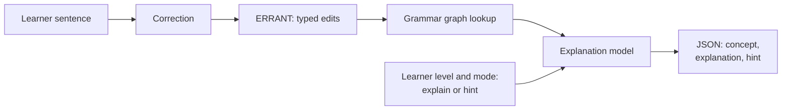

# Explain-to-Learn

A small, locally runnable model that turns grammar corrections in English learners' writing into short explanations or hints, matched to the learner's CEFR level and grounded in a teacher-built grammar graph.

> **Status: in development.** There are no results yet. The results table, demo link and example outputs will be added as the work is done, including any negative results.

## What it does

A B1 learner writes *"She don't like to going."* The system finds two edits, labels them (subject-verb agreement; verb form after *like to*) and returns one short explanation per edit. It can also return a hint instead of the answer, for example "Check the verb after *she*." Offering a hint is a choice taken from second-language feedback research.

**Research question:** does grounding a small fine-tuned model in a teacher-built grammar graph make its explanations more correct, and better matched to learner level, than prompting alone?

## How it works



1. **Correction and edits.** Training and the main evaluation use the corpus's gold corrections, so explanation quality is measured separately from correction quality. The end-to-end demo adds a correction model. [ERRANT](https://github.com/chrisjbryant/errant) splits each correction into typed edits.
2. **Grounding.** Each ERRANT error type maps to a concept in the grammar graph. A concept has a rule worded for A2, B1 and B2, a short example and its prerequisite concepts. The graph is stored as YAML and loaded with NetworkX.
3. **Explanation.** A small open-weight instruction model (3 to 4B parameters), fine-tuned with LoRA, takes the sentence, the edit, its error type, the graph snippet, the learner level and the mode. It returns JSON with the concept, a one- or two-sentence explanation and a hint.

## Systems compared

| System | Model | Graph grounding | What it tests |
| --- | --- | --- | --- |
| A | Base model, prompted | No | Baseline |
| B | Base model, prompted | Yes | Effect of grounding alone |
| C | LoRA-tuned | No | Effect of fine-tuning alone |
| D | LoRA-tuned | Yes | Full system |

A larger open-weight model with the graph is run as a reference point.

## Evaluation

- **Automatic metrics** on 300 gold edits: coverage, concept accuracy, faithfulness (names the edited words and doesn't contradict the graph rule) and level fit.
- **Blind teacher ratings** on 400 items (100 edits × 4 systems, shuffled, system names hidden), adapting the [BEA 2025 shared-task](https://arxiv.org/abs/2507.10579) dimensions: rule correct, error located, helps the learner fix it, fits the level, plus a flag for invented rules.
- **Agreement:** a second teacher rates 50 items (Cohen's kappa), and an LLM judge using the same rubric is checked against the human ratings.
- **Analysis:** paired bootstrap confidence intervals, broken down by error type and learner level.

## Results

Not available yet.

## Quick start

Requires Python 3.11 or newer. The data pipeline needs only the standard library.

```bash
python -m venv .venv && source .venv/bin/activate
pip install -e ".[dev]"
```

Download the corpora into `data/raw/` (git-ignored). The script prints the licence terms and only downloads with the flag:

```bash
bash scripts/download_data.sh --accept-licence
```

Build the edit table, the essay split files, the gold edit IDs and the data statistics:

```bash
python -m explain_to_learn.edits build --raw data/raw --out data/processed/edits.jsonl
python -m explain_to_learn.splits --edits data/processed/edits.jsonl --out data/splits
python scripts/data_stats.py --edits data/processed/edits.jsonl --out eval/results/data_stats.md
```

The edit table rebuilds with the same edit IDs as `data/splits/gold_edit_ids.txt`. Run the linter and tests:

```bash
ruff check . && pytest
```

Other extras: `graph`, `data` (ERRANT and spaCy), `model` and `demo`. For `model`, first install a PyTorch build for CUDA 12.8 or newer (needed for Blackwell GPUs), for example `pip install torch --index-url https://download.pytorch.org/whl/cu128`.

## Data

| Dataset | Role |
| --- | --- |
| W&I+LOCNESS (BEA-2019) | Main source of edits and learner levels; evaluation on the dev set |
| FCE (BEA-2019 version) | Extra training edits |
| GEE data (Song et al., 2024) | Explanation format and comparison point |
| Grammar graph (this repo) | 40 to 60 teacher-written concepts that ground every explanation |
| Gold set (this repo) | 300 edits with teacher-written or teacher-rated explanations |

Raw learner text is not stored in this repository. The repo will hold scripts and edit IDs, so you can rebuild the data after downloading the corpora under their own licences.

## Planned layout

```
├── scripts/download_data.sh   # raw corpora stay git-ignored
├── grammar_graph/             # concepts.yaml, errant_map.yaml
├── src/explain_to_learn/      # edits, graph, prompts, generate, metrics
├── train/                     # LoRA configuration and training scripts
├── notebooks/                 # data analysis and result notebooks
├── eval/                      # rubric and results
├── demo/app.py                # Gradio demo
├── tests/
└── report/
```

## Roadmap

- [ ] Data pipeline: download script, edit table with essay IDs and levels, essay-level splits, data statistics
- [ ] Grammar graph: concepts, ERRANT type mapping, prerequisite links, validation
- [ ] Prompted baselines (A, B) and automatic metrics
- [ ] Silver training explanations, filtered and hand-checked, with a data card
- [ ] LoRA fine-tuning (C, D) on a single 32 GB GPU, run logging, adapters on the Hugging Face Hub
- [ ] Gold-set evaluation: blind ratings, second rater, LLM judge
- [ ] Analysis: confidence intervals, per-error-type and per-level breakdowns
- [ ] Gradio demo, model card, short report and v1.0 release

## Known limitations

- English only, on teen and adult exam-style writing, not children's writing.
- One main rater; agreement is measured on a subset only.
- Silver training data from a larger model may carry that model's biases.
- The main evaluation assumes gold corrections; in real use, correction errors carry through to the explanations.
- About 50 concepts; rare errors fall back to generic explanations.

## Credits

- Cambridge English Write & Improve (W&I): Yannakoudakis, Andersen, Geranpayeh, Briscoe and Nicholls (2018), *Developing an automated writing placement system for ESL learners*, Applied Measurement in Education.
- LOCNESS: Centre for English Corpus Linguistics (CECL), Université catholique de Louvain, Belgium.
- FCE: Yannakoudakis, Briscoe and Medlock (2011), *A New Dataset and Method for Automatically Grading ESOL Texts*, ACL-HLT.
- BEA-2019 versions of W&I+LOCNESS and FCE: Bryant, Felice, Andersen and Briscoe (2019), *The BEA-2019 Shared Task on Grammatical Error Correction*.
- ERRANT: Bryant et al. (2017), *Automatic Annotation and Evaluation of Error Types for Grammatical Error Correction*.
- GEE: Song et al. (2024), *GEE! Grammar Error Explanation with Large Language Models*, Findings of NAACL.
- BEA 2025 shared task on the pedagogical ability of AI tutors.

## Licence

The code is released under the [MIT License](LICENSE). The datasets keep their own licences: W&I+LOCNESS and FCE may be used for non-commercial research and education only, and must be downloaded from the [BEA-2019 shared-task page](https://www.cl.cam.ac.uk/research/nl/bea2019st/).
