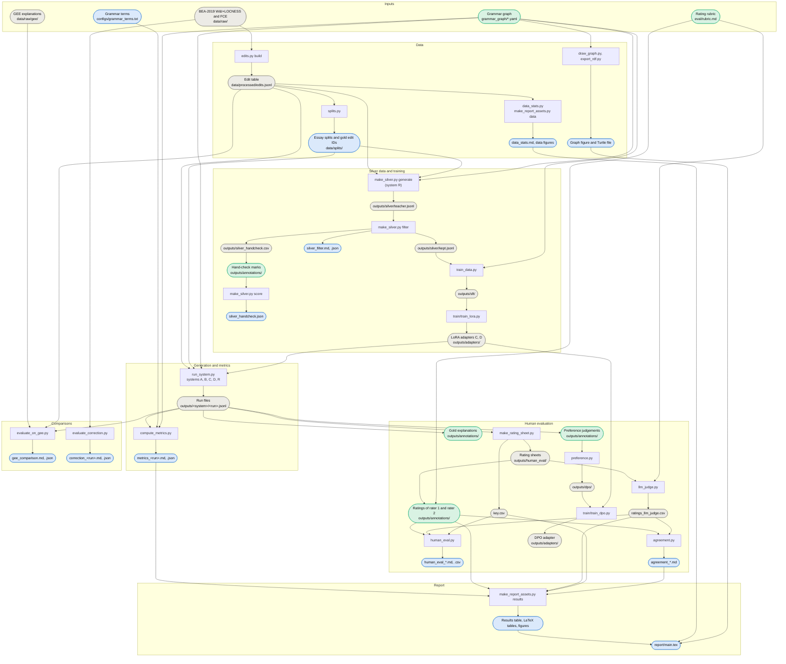

# Architecture

This document is for a reader meeting the code for the first time. It describes what
each module and script does and what it depends on, how data flows from the raw corpora
to the report, every intermediate file, the configuration files, and where randomness
enters. The reasons behind the main choices are in
[design_decisions.md](design_decisions.md), and the order in which the steps are run is
in the runbook, [experiments.md](experiments.md).

## Contents

1. [Overview](#overview)
2. [Data flow](#data-flow)
3. [Module map](#module-map)
4. [Intermediate files](#intermediate-files)
5. [Configuration](#configuration)
6. [Randomness and seeds](#randomness-and-seeds)

## Overview

The code has four parts:

- **The package** (`src/explain_to_learn/`) holds all the logic that more than one
  entry point needs: the edit table, the grammar graph, prompts, generation, metrics,
  silver-data filtering, training data, human-evaluation summaries, the end-to-end
  pipeline and the local annotation app. It is installed with `pip install -e .`, and
  each heavy dependency comes with an optional extra (`data`, `graph`, `generate`,
  `model`, `demo`, `analysis`, `train`).
- **The scripts** (`scripts/`) are the command-line steps of the experiments, one per
  step. Each reads files, calls package functions and writes files; only the report's
  tables and figures are drawn by code that lives in a script
  (`make_report_assets.py`).
- **Training** (`train/`) holds the LoRA and DPO training scripts and their configs.
  They read the training examples that the package writes and do not import the
  package.
- **The demo** (`demo/`) is a Gradio app on top of the same pipeline as the
  `explain-to-learn` command.

Inside the package, a module imports only modules from its own layer or the layers
before it in this list:

1. Files and data: `io` (file formats), `edits` (the edit table), `splits`.
2. Teaching knowledge: `graph` (the grammar graph).
3. Model input and output: `prompts`, `generate`.
4. Scoring and data building: `metrics`, `silver`, `train_data`, `preference`,
   `human_eval`, `gee`.
5. Assembly: `pipeline`, `summary`, `cli`, and the `annotation` app.

The one exception is `io.open_graph`, which imports `graph` when it is called. `graph`
needs NetworkX and PyYAML, so code that uses the graph for only some of its work (an
ungrounded system, for example) loads it this way and runs without the `graph` extra.

Learner text never enters the repository. Everything that quotes it is written to the
git-ignored `data/raw/`, `data/processed/` and `outputs/` folders; only edit IDs and
aggregate tables are committed (see [Intermediate files](#intermediate-files)).

## Data flow

Rectangles are scripts or modules; rounded boxes are files. Green boxes are the
teacher's own work, blue boxes are committed files, and grey boxes stay local because
they quote learner text (or, for `key.csv`, must stay hidden from raters).

The diagram leaves out the paths that serve free text rather than the experiments: the
`explain-to-learn` command and the demo run `pipeline.py` and `summary.py` on a text the
user types, with a correction model or a given correction, ERRANT, the grammar graph
and the system D adapter, and print their answer without writing files.

## Module map

### Package: `src/explain_to_learn/`

**`__init__.py`** holds the package docstring and `__version__`.

**`io.py`** holds the file helpers that the rest of the code shares: `read_ids` and
`write_ids` for text files with one ID per line, `read_rows`, `write_rows` and
`read_run` for JSON Lines files, `read_csv` and `write_csv` for CSV files with a header
row, `open_graph` to load the grammar graph from its folder, and `name_and_path` for
`NAME=PATH` arguments. Every file is read and written as UTF-8. Depends on the standard
library only; `open_graph` imports `graph` when it is called.

**`edits.py`** builds the edit table. It reads the BEA-2019 JSON files (one essay per
line, with its ID and CEFR level) and the official M2 files (tokenised sentences with
typed ERRANT edits, but no essay IDs), aligns the M2 sentences to the essays by their
characters (`align_essays`) and writes one row per edit with its essay, split and level
(`Edit`, `build_edits`, `write_jsonl`, `read_jsonl`). It also defines `LEVELS`, the
level values of the table. Depends on the standard library only.

**`splits.py`** checks that no essay is in two splits, writes one file of essay keys per
split, and draws the 300 gold edits from the W&I+LOCNESS development set, stratified by
error category and level (`allocate`, `sample_gold`). Depends on `edits` and `io`.

**`graph.py`** loads the teacher-written grammar graph (`concepts.yaml`,
`errant_map.yaml`) into a NetworkX graph, looks up the concept of an ERRANT error type
(`concept_for`), returns the grounding snippet with the rule worded for a learner's
level (`snippet`), lists the grammar terms a level may use (`level_terms`) and validates
the files (`python -m explain_to_learn.graph validate`). Depends on NetworkX and PyYAML
(the `graph` extra).

**`prompts.py`** builds the model input: the system prompt, and a user message with the
sentence, the edit, its error type, the level, the mode (explain or hint) and, for
grounded systems, the graph snippet (`build_messages`). `build_target` writes the JSON
answer used as the training target. `detokenize` turns M2 tokens into readable text.
Depends on `edits`.

**`generate.py`** runs a model on edits. `OpenAIBackend` calls an OpenAI-compatible
server (vLLM, llama.cpp) with the standard library; `TransformersBackend` loads a
Hugging Face model, with an optional LoRA adapter, in the process. `generate` asks
again (once by default) when the reply is not valid JSON, and records errors instead of
raising them.
`parse_output` extracts the `concept`, `explanation` and `hint` fields from replies with
reasoning blocks, code fences or extra text. `edit_item` pairs a generation record with
its messages, `run_batch` appends one line per edit to a run file, and `load_systems`
reads `configs/systems.yaml`. Depends on `edits`, `io` and `prompts`; PyYAML for the
config, and PyTorch, Transformers and PEFT for the local backend (`model` extra).

**`metrics.py`** scores each reply per edit (`score_item`): coverage, concept accuracy,
faithfulness (the text names the edited words; a hint does not give the answer away),
length fit and off-level grammar terms. `summarize` and `breakdown` aggregate the scores
overall, per level and per error category, and `paired_bootstrap` compares two systems
on the same edits. It also scores a correction model with ERRANT's span-based F0.5
(`correction_f05`) and writes the metrics report. Depends on `edits` and `prompts`;
ERRANT (the `data` extra) runs in a subprocess for the correction score, and the
optional rule-contradiction check needs Transformers.

**`silver.py`** prepares the silver training data: a seeded sample of training edits
(`select_training_edits`), a seeded share of them in hint mode (`assign_modes`), the
filter that keeps a teacher output only if it parses, names the graph concept and
names the edited words (`filter_silver`, with the first failed check as the rejection
reason), the hand-check sample (`export_handcheck`) and its accuracy with a Wilson
interval (`handcheck_accuracy`). Depends on `edits`, `io`, `metrics` and `prompts`.

**`train_data.py`** turns the kept silver items into supervised fine-tuning examples in
TRL's prompt-completion format, one set for system C (no graph snippet) and one for
system D (with it), split into training and validation by essay. Depends on `edits`,
`generate`, `io` and `prompts`; `graph` for its command.

**`preference.py`** turns the teacher's pairwise judgements into DPO pairs in TRL's
conversational preference format, skipping ties and "both bad", split by essay. Depends
on `generate`, `io`, `prompts` and `train_data`.

**`human_eval.py`** holds what the rating scripts share: the rubric's dimensions and
scales, the columns of the rating sheet, the key and the ratings, and `read_ratings`.
Its command joins a ratings file with the key and writes mean ratings per system, error
category and level. Depends on `io`.

**`gee.py`** reads GEE's English explanations (Song et al., 2024), pairs each explanation
with its atomic edit, and pairs each atomic edit with the official edit of the same
sentence and words in the edit table (`read_gee`, `match_edits`). Depends on `edits`.

**`pipeline.py`** is the end-to-end path for free text: sentence splitting and ERRANT
edits (`ErrantAnnotator`), a correction model (`GecCorrector`, or `EndpointCorrector`
for a prompted chat model), and the explanation step (`Explainer`, `explain_edits`) that
uses the same `edit_item` and `generate` as the evaluation. `explain_text` runs every
step on a text, and `explain_gold_edits` explains edit-table rows. Every step is an
object with one or two methods, so tests and the demo's preview mode replace them with
stubs. Depends on `edits`, `generate`, `metrics` and `prompts`; ERRANT and spaCy (the
`data` extra) and Transformers for the real annotator and corrector.

**`summary.py`** writes the teacher summary of one text without any model: its edits
grouped by graph concept, with positions, in a teaching order where each concept comes
after the prerequisites that also have errors in the text. Depends on `edits` and
`prompts`, and on a loaded grammar graph passed in.

**`cli.py`** is the `explain-to-learn` command: `explain` gives feedback on a text and
`summary` writes the teacher summary of a text or of an essay in the edit table.
Depends on `edits`, `generate`, `io`, `pipeline`, `prompts` and `summary`.

### Annotation app: `src/explain_to_learn/annotation/`

A local Gradio app (`python -m explain_to_learn.annotation`) with one tab per teacher
task. [annotation_guide.md](annotation_guide.md) describes it for raters.

- **`__main__.py`** parses the options (input files per task, output folder, port) and
  starts the app on 127.0.0.1. Depends on `io`; Gradio through `app.py`.
- **`app.py`** lays out the tabs and connects the Start, Back and Save-and-next buttons
  and the keyboard shortcuts to the tasks; all logic is in the task classes. Depends on
  Gradio (the `demo` extra), `human_eval` and the task modules.
- **`task.py`** defines `Task`, the interface every task implements: items in a fixed
  order, `view`, `values` and `save`. Depends on `store`.
- **`store.py`** saves one record per item and rewrites the whole file through a
  temporary file after every save, so a task resumes at the first unsaved item and a
  crash loses at most the item on screen. Depends on `io`.
- **`display.py`** escapes Markdown and marks the edit in a sentence. Depends on
  `edits` and `prompts`.
- **`gold.py`**, **`ratings.py`**, **`handcheck.py`** and **`preferences.py`** are the
  tasks: reference explanations and hints for the gold edits, blind ratings (which
  refuse any file with a system column), the silver hand-check, and pairwise
  preferences shown in a seeded left/right order. They depend on `display`, `store`,
  `task` and, as needed, `edits`, `generate`, `graph` (through `io`), `human_eval`,
  `metrics`, `prompts` and `silver`.

### Scripts: `scripts/`

**`download_data.sh`** prints the corpus licence terms and, with `--accept-licence`,
downloads and checks the W&I+LOCNESS and FCE archives and clones the GEE repository into
`data/raw/`. Needs `curl`, `sha256sum`, `tar` and `git`.

**`serve_model.sh`** starts an OpenAI-compatible vLLM server in Docker for a model and
any number of LoRA adapters. Needs Docker with GPU access.

**`data_stats.py`** writes counts of the edit table per corpus, split, level, operation
and error category to `eval/results/data_stats.md`. Depends on `edits`.

**`draw_graph.py`** draws the grammar graph's prerequisite links, and
**`export_rdf.py`** exports the graph as RDF Turtle with SKOS terms. Depend on `graph`,
with Matplotlib and rdflib (the `graph` extra).

**`concept_examples.py`** writes, for each concept, its ERRANT error types, their edit
counts per level and random example edits from training essays, to help the teacher
write the graph. Depends on `edits`, `graph`, `io` and `prompts`.

**`run_system.py`** runs one system (A, B, C, D or R) on a list of edit IDs and appends
one line per edit to its run file; a stopped run resumes. Depends on `edits`, `generate`
and `io`.

**`compute_metrics.py`** scores each system's run file on the same edits and writes the
metrics report with breakdowns and paired bootstrap comparisons (B-A, C-A, D-B, D-C by
default). Depends on `edits`, `io`, `metrics` and `prompts`.

**`make_silver.py`** has three steps: `generate` runs the teacher (system R) on a seeded
sample of training edits, `filter` keeps the usable outputs and exports the hand-check
sample, and `score` reports the hand-check accuracy. Depends on `edits`, `generate`,
`io` and `silver`.

**`make_rating_sheet.py`** samples gold edits, takes each system's output for them,
shuffles the items and writes the blind rating sheet, the second rater's subset and the
key. Depends on `edits`, `human_eval`, `io`, `metrics` and `prompts`.

**`agreement.py`** compares two sets of ratings of the same items per dimension: exact
agreement, Cohen's kappa and, for the three-point dimensions, quadratic-weighted kappa.
Depends on `human_eval`.

**`llm_judge.py`** rates the rating sheet with a model on an OpenAI-compatible endpoint,
with the rubric as its instructions, and writes the same columns as a human rater.
Depends on `human_eval` and `io`.

**`evaluate_correction.py`** corrects every W&I+LOCNESS development sentence with a
configured corrector and scores the corrections with ERRANT against the official M2
files, overall and per level. Depends on `edits`, `metrics`, `pipeline`, `prompts` and
`splits`; ERRANT and spaCy.

**`evaluate_on_gee.py`** has three steps: `prepare` matches GEE's explanations to the
edit table, `run` runs a system on the matched edits through `run_system.py`, and
`compare` scores GEE and the systems on coverage and faithfulness and writes a
side-by-side sheet for a teacher. Depends on `edits`, `gee`, `io`, `metrics`, `prompts`
and `silver`, and runs systems through `run_system.py`.

**`make_report_assets.py`** has two steps: `data` draws the data figures from the edit
table, and `results` turns the metrics, ratings and agreement files into the README
results table, the report's LaTeX tables and its figures. Missing inputs are skipped.
Depends on `edits`, `human_eval`, `io` and `metrics`; Matplotlib and NumPy (the
`analysis` extra).

### Training: `train/`

**`train_lora.py`** trains one LoRA adapter for system C or D on the examples from
`train_data.py`, with Unsloth or plain TRL and PEFT, and saves the adapter with
`run_info.json` (settings, data sizes, losses, peak GPU memory, run time, library
versions). It can log to Weights & Biases or MLflow and push the adapter to the Hugging
Face Hub. It also holds the helpers that `train_dpo.py` reuses. Depends on PyYAML and
the `train` extra, and needs a CUDA GPU.

**`train_dpo.py`** continues training the system D adapter with DPO on the pairs from
`preference.py`, with a frozen copy of the same adapter as the reference model. Depends
on `train_lora.py` and the `train` extra, and needs a CUDA GPU.

**`lora_config.yaml`** and **`dpo_config.yaml`** hold the training settings and their
variants (see [Configuration](#configuration)).

### Demo: `demo/`

**`app.py`** is a Gradio app with a feedback tab for learners and a summary tab for
teachers, both on `pipeline.py` and `summary.py`. With `--fake` it runs without models.
Every option can also be set with a `DEMO_<NAME>` environment variable, which is how a
Hugging Face Space configures it. Depends on `generate`, `io`, `pipeline`, `summary` and
`stubs`; Gradio, and optionally `spaces` on a ZeroGPU Space.

**`stubs.py`** holds the preview mode's stand-ins: a rule-based corrector, a token-diff
annotator and a backend that returns placeholder JSON. Depends on `generate`, `pipeline`
and `prompts`.

**`requirements.txt`** lists the packages a Hugging Face Space installs, and
**`README.md`** explains how to run and deploy the demo.

### Other folders

- `configs/`: `systems.yaml` (models, adapters, servers, correctors) and
  `grammar_terms.txt` (terms for the level-fit metric).
- `grammar_graph/`: the teacher's concepts and ERRANT mapping; its README describes
  the formats.
- `data/splits/`: the essay split files and the gold edit IDs.
- `eval/`: the rubric (`rubric.md`) and the committed aggregate results (`results/`).
- `notebooks/`: `01_data_statistics.ipynb` and `02_results_analysis.ipynb` call
  `make_report_assets.py` and show its figures.
- `report/`: the ACL-format report, its bibliography, tables and figures.
- `docker/`: the training image for the RTX 5090.
- `tests/`: unit and integration tests on invented sentences, with fake models, so no
  test needs a GPU or the corpora. Tests that need ERRANT, Gradio or TRL skip when the
  package is missing.

## Intermediate files

"Committed" files hold only IDs, counts, means and intervals; they belong in the
repository once their step has run. "Local" files are in the git-ignored `data/` or
`outputs/` folders, because they quote learner text (or text from GEE, which has no
licence), or because they sit next to such files. A dash under "Read by" means that
people read the file, not code.

### Inputs

| Path | Written by | Read by | Contents | In git |
| --- | --- | --- | --- | --- |
| `data/raw/wi+locness/`, `data/raw/fce/` (`json/*.json`, `m2/*.m2`) | `download_data.sh` | `edits.py`, `evaluate_correction.py` | BEA-2019 essays (ID, CEFR level, text) and official M2 edits | Local |
| `data/raw/gee/data/human_annotation_data/en_anonymized.json` | `download_data.sh` | `evaluate_on_gee.py prepare` (`gee.py`) | GEE sentence pairs, atomic edits, explanations and annotator labels | Local |
| `grammar_graph/concepts.yaml`, `errant_map.yaml` | the teacher, by hand | `graph.py`, through every grounded step | Concepts (name, status, rule per band, example, prerequisites, terms) and the concept of each ERRANT category | Committed |
| `eval/rubric.md` | the teacher, by hand | the annotation app (rubric panel), `llm_judge.py` (instructions) | The rating dimensions, scales and decision rules | Committed |
| `configs/grammar_terms.txt` | by hand | `metrics.load_terms` in `compute_metrics.py` | One grammar term per line | Committed |

### Edit table and splits

| Path | Written by | Read by | Contents | In git |
| --- | --- | --- | --- | --- |
| `data/processed/edits.jsonl` | `edits.py build` | `splits.py`, `data_stats.py`, `concept_examples.py`, `run_system.py`, `compute_metrics.py`, `make_silver.py`, `train_data.py`, `make_rating_sheet.py`, `evaluate_on_gee.py`, `make_report_assets.py data`, `cli.py summary --essay`, the gold and preference tasks | One edit per line: `edit_id`, `corpus`, `essay_id`, `split`, `cefr_level`, `sent_idx`, `original`, `corrected`, `start`, `end`, `original_text`, `corrected_text`, `error_type`, `operation`, `error_category` | Local |
| `data/splits/{train,dev,test}_essays.txt` | `splits.py` | `make_silver.py generate` and `concept_examples.py` (training essays) | Essay keys (`{corpus}-{essay_id}`), one per line | Committed |
| `data/splits/gold_edit_ids.txt` | `splits.py` | `run_system.py`, `compute_metrics.py`, `make_rating_sheet.py`, the gold task, `make_silver.py generate` (excluded), `evaluate_on_gee.py prepare` (counted) | The 300 gold edit IDs | Committed |
| `eval/results/data_stats.md` | `data_stats.py` | – | Counts per corpus, split, level, operation and category | Committed |
| `report/figures/data_*.png` | `make_report_assets.py data` | the report | Four charts of the edit table | Committed |
| `report/figures/grammar_graph.png`, `report/grammar_graph.ttl` | `draw_graph.py`, `export_rdf.py` | the report, RDF tools | The prerequisite graph as a figure and as SKOS Turtle | Committed |
| `outputs/concept_examples/<concept_id>.md`, `index.md` | `concept_examples.py` | – | Error types, counts per level and example training edits per concept | Local |
| `outputs/dev_ids.txt` | the runbook's step 4 | `run_system.py --ids`, `compute_metrics.py --ids` | 500 development edit IDs outside the gold set | Local |

### Generation and automatic metrics

| Path | Written by | Read by | Contents | In git |
| --- | --- | --- | --- | --- |
| `outputs/<system>/<run>.jsonl` | `run_system.py` (`evaluate_on_gee.py run` writes `gee.jsonl`) | `compute_metrics.py`, `make_rating_sheet.py`, `evaluate_on_gee.py compare`, the gold task (`--drafts`), the preference task (`--pair`) | One generation record per edit: `system`, `run`, `edit_id`, `level`, `mode`, `grounded`, `concept_id`, `concept_name`, `raw`, `parsed` (`concept`, `explanation`, `hint`, or null), `attempts`, `latency_s`, `error` | Local |
| `eval/results/metrics_<run>.md`, `.json` | `compute_metrics.py` | `make_report_assets.py results` | Per system: summary overall, `by_level` and `by_error_category` (means and counts of `covered`, `concept_correct`, `faithful`, `contradicts_rule`, `within_length`, off-level term shares); `comparisons` with paired bootstrap `diff`, `low`, `high`, `p_value`; optional `correction` scores | Committed |

### Silver data and training

| Path | Written by | Read by | Contents | In git |
| --- | --- | --- | --- | --- |
| `outputs/silver/teacher.jsonl` | `make_silver.py generate` | `make_silver.py filter` | Generation records of system R, as in a run file without `run` | Local |
| `outputs/silver/kept.jsonl` | `make_silver.py filter` | `train_data.py` | `edit_id`, `level`, `mode`, `concept_id`, `concept`, `explanation`, `hint`, `target` | Local |
| `eval/results/silver_filter.md`, `.json` | `make_silver.py filter` | – | `total`, `kept` and the count of each rejection reason | Committed |
| `outputs/silver_handcheck.csv` | `make_silver.py filter` | the silver hand-check task; `make_silver.py score` by default | `edit_id`, `level`, `mode`, `error_type`, `sentence`, `original_text`, `corrected_text`, `concept`, `explanation`, `hint`, `correct` (empty) | Local |
| `outputs/annotations/silver_handcheck.csv` | the silver hand-check task | `make_silver.py score --handcheck` | The same columns with `correct` set to 1 or 0, plus `note` | Local |
| `eval/results/silver_handcheck.json` | `make_silver.py score` | – | `rated`, `correct`, `unrated`, `accuracy`, Wilson `low` and `high` | Committed |
| `outputs/sft/system_{c,d}/{train,validation}.jsonl` | `train_data.py` | `train_lora.py` | `edit_id`, `essay_key`, `system`, `mode`, `level`, `grounded`, `prompt` (chat messages), `completion` (the assistant's JSON answer) | Local |
| `outputs/adapters/<run>/` | `train_lora.py`, `train_dpo.py` | `run_system.py` (through `adapter` in `systems.yaml` or `--adapter`), `serve_model.sh`, the demo, `train_dpo.py` (the D adapter) | PEFT adapter files and `run_info.json` (settings, data sizes, losses, peak GPU memory, time, versions) | Local; adapters go to the Hugging Face Hub |
| `outputs/checkpoints/<run>/` | `train_lora.py`, `train_dpo.py` | – | The trainer's working folder; no checkpoints are saved | Local |

### Human evaluation and preferences

| Path | Written by | Read by | Contents | In git |
| --- | --- | --- | --- | --- |
| `outputs/human_eval/rating_sheet.csv`, `rating_sheet_second_rater.csv` | `make_rating_sheet.py` | the rating tasks, `llm_judge.py` | `item_id`, `level`, `mode`, `sentence`, `corrected`, `edit`, `feedback`, and empty rating columns | Local |
| `outputs/human_eval/key.csv` | `make_rating_sheet.py` | `human_eval.py`, `make_report_assets.py results` | `item_id`, `system`, `edit_id`, `error_category`, `level`, `mode` | Local (no learner text, but hidden from raters until rating is done) |
| `outputs/annotations/ratings_<rater>.csv`, `.json` | the rating tasks of the annotation app | `human_eval.py`, `agreement.py`, `make_report_assets.py results` | `item_id`, `rule_correct`, `error_located`, `helps_fix`, `fits_level` (no, partly, yes), `invented_rule` (no, yes), `comment`; the `.json` holds the rater, the sheet and its fingerprint | Local |
| `outputs/human_eval/ratings_llm_judge.csv`, `.json` | `llm_judge.py` | `agreement.py`, `human_eval.py`, `make_report_assets.py results` | The same rating columns; the `.json` holds the judge model, settings, rubric hash and failure count | Local |
| `eval/results/human_eval_<name>.md`, `_by_{system,category,level}.csv` | `human_eval.py` | – | Item counts, mean ratings and the invented-rule share per group | Committed |
| `eval/results/agreement_<name>.md` | `agreement.py` (`--out`) | `make_report_assets.py results` | Items, exact agreement, Cohen's kappa and weighted kappa per dimension | Committed |
| `outputs/annotations/gold_explanations.jsonl` | the gold task | – (the reference set) | `edit_id`, `level`, `error_type`, `concept_id`, `concept`, `explanation`, `hint`, `not_rule_explainable`, `notes`, `from_draft` | Local |
| `outputs/annotations/preferences.jsonl` | the preference task | `preference.py` | `edit_id`, `level`, `mode`, `prompt_messages`, `chosen`, `rejected`, `source_systems`, `judgement` | Local |
| `outputs/dpo/{train,validation}.jsonl` | `preference.py` | `train_dpo.py` | `edit_id`, `essay_key`, `level`, `mode`, `source_systems`, `prompt`, `chosen`, `rejected` | Local |

`make_report_assets.py results` reads the first rater's ratings from
`outputs/human_eval/ratings_rater1.csv` and the judge agreement from
`eval/results/agreement_judge.md` by default; `--ratings` and `--agreement-judge` point
it elsewhere. Likewise `make_silver.py score` reads `outputs/silver_handcheck.csv`
unless `--handcheck` names the app's marks file.

### Comparisons

| Path | Written by | Read by | Contents | In git |
| --- | --- | --- | --- | --- |
| `outputs/gee/edit_ids.txt` | `evaluate_on_gee.py prepare` | `evaluate_on_gee.py run` | The matched edit IDs | Local |
| `outputs/gee/references.jsonl` | `evaluate_on_gee.py prepare` | `evaluate_on_gee.py compare` | `edit_id`, `gee_id`, `operation`, `original`, `corrected`, `explanation`, `error_type`, `flags`, `all_correct` | Local |
| `outputs/gee/prepare_counts.json` | `evaluate_on_gee.py prepare` | `evaluate_on_gee.py compare` | Counts of records used, skipped, matched and dropped | Local |
| `outputs/gee/side_by_side.csv` | `evaluate_on_gee.py compare` | – (a teacher) | The edit, GEE's explanation and flags, one column per system, `preferred` and `comment` (empty) | Local |
| `eval/results/gee_comparison.md`, `.json` | `evaluate_on_gee.py compare` | – | Coverage and faithfulness shares with Wilson intervals, paired differences from GEE, and the counts | Committed |
| `outputs/correction/<run>/` | `evaluate_correction.py` | `evaluate_correction.py` (resumes from `hyp.txt`) | `orig.txt`, `hyp.txt`, `hyp.m2`, `ref.m2` and `levels/<level>.{hyp,ref}.m2` | Local |
| `eval/results/correction_<run>.md`, `.json` | `evaluate_correction.py` | – | The corrector's settings; TP, FP, FN, precision, recall and F0.5 overall and per level | Committed |

### Report

| Path | Written by | Read by | Contents | In git |
| --- | --- | --- | --- | --- |
| `eval/results/results_table.md` | `make_report_assets.py results` | – (copied into the README) | One row per metric, one column per system, with 95% intervals | Committed |
| `report/tables/{results_main,paired_differences,agreement}.tex` | `make_report_assets.py results` | the report | Booktabs tables | Committed |
| `report/figures/{paired_differences_*,results_by_*,human_by_*,judge_*}.png` | `make_report_assets.py results` | the report, `02_results_analysis.ipynb` | Interval plots of the results | Committed |

## Configuration

### `configs/systems.yaml`

Read by `generate.load_systems` (systems) and `pipeline.load_correctors` (correctors).

| Setting | Controls |
| --- | --- |
| `defaults` | Values every system starts from; a system's own keys replace them, and its `decoding` is merged key by key. |
| `retries` | How often `generate.generate` asks again after a reply that is not valid JSON (default 1). |
| `decoding.temperature`, `top_p`, `max_new_tokens`, `seed` | The `Decoding` settings of every request. Temperature 0 means greedy decoding. |
| `systems.<name>.description` | A note for readers; the code does not read it. |
| `model` | The Hugging Face model ID, loaded in the process or, without `served_model`, requested from the server. |
| `adapter` | The LoRA adapter (a local folder or a Hub ID) for the `transformers` backend; `run_system.py --adapter` and the demo's `--adapter` replace it. |
| `served_model` | The model name sent to the server with the `openai` backend, for example the adapter name `system-d` that `serve_model.sh` registers. |
| `grounded` | Whether the prompt gets the grammar graph snippet (B, D and R). |
| `backend` | `transformers` (load the model in the process) or `openai` (call a server). |
| `base_url`, `timeout_s`, `extra_body` | The server address, the request timeout and extra request fields such as `reasoning_effort` for the `openai` backend. |
| `dtype` | Optional; the weight type of the `transformers` backend (default `bfloat16`). |
| `correctors.<name>.kind` | `gec` (a sequence-to-sequence correction model) or `endpoint` (a chat model prompted to correct). |
| `correctors.gec.model`, `prefix`, `num_beams`, `batch_size` | The correction model, the task prefix added to each sentence, the beam width and the sentences per batch. |
| `correctors.llm.model`, `base_url`, `workers`, `decoding` | The served chat model, its server, the parallel requests and the decoding settings. |

`API_KEY`, if set in the environment, is sent as the bearer token to every server and
passed to vLLM by `serve_model.sh`.

### `train/lora_config.yaml` and `train/dpo_config.yaml`

Both files have `defaults`, the main run, and `variants`, each of which changes only
the keys it lists (`train_lora.load_config` merges them). The comments in the files
explain each value.

| Setting | Controls |
| --- | --- |
| `seed` | Data order, adapter initialisation and dropout (see below). |
| `model.name` | The base model. |
| `model.max_seq_length` (LoRA), `model.max_length` (DPO) | Tokens of prompt and answer per example; longer examples are counted and truncated. |
| `model.load_in_4bit` (LoRA) | bf16 base weights (LoRA) or 4-bit quantised ones (QLoRA). |
| `model.adapter` (DPO) | The system D adapter that DPO continues to train and copies as its reference. |
| `lora.rank`, `alpha`, `dropout`, `target_modules` | The LoRA adapter's size, scale, dropout and the projections it adapts. |
| `training.epochs`, `learning_rate`, `lr_scheduler`, `warmup_ratio`, `weight_decay`, `optimizer` | The optimisation schedule. |
| `training.batch_size`, `gradient_accumulation`, `gradient_checkpointing` | Memory use; the effective batch is the product of the first two. |
| `training.beta`, `loss_type` (DPO) | The strength of the pull towards the reference model, and the DPO loss. |
| `training.logging_steps` | How often the loss is logged. |
| `logging.report_to`, `project` | Run logging (`none`, `wandb` or `mlflow`; `--report-to` overrides it) and the project or experiment name. |
| `variants` | LoRA: `r16` (the defaults), `r8`, `r32`, `qlora_r16`. DPO: `beta01` (the defaults), `beta03`. |

### Other settings

- `configs/grammar_terms.txt` lists the grammar terms that the level-fit metric looks
  for; the graph's `terms` say which of them suit each level.
- `grammar_graph/concepts.yaml` and `errant_map.yaml` are content rather than settings;
  [grammar_graph/README.md](../grammar_graph/README.md) describes them.
- Values set in the code rather than in a config file: the word and sentence limits of
  the level-fit metric (`metrics.LENGTH_LIMITS`, `MAX_SENTENCES`), the mapping of
  learner levels to the graph's three rule bands (`graph.LEVEL_TO_BAND`), and the
  defaults of the script options, such as the gold-set size (300, `splits.py --n-gold`)
  and the share of hint-mode silver items (0.25, `make_silver.py generate --hint-share`).
- Environment variables: `HF_TOKEN` (model downloads, Hub uploads), `WANDB_API_KEY`,
  `WANDB_PROJECT` and `MLFLOW_EXPERIMENT_NAME` (run logging), `API_KEY` (servers), the
  `DEMO_<NAME>` options of the demo, and the server settings of `serve_model.sh`
  (`PORT`, `VLLM_IMAGE`, `MAX_MODEL_LEN`, `GPU_MEMORY_UTILIZATION`, `MAX_LORA_RANK`,
  `HF_CACHE`).
- `pyproject.toml` defines the extras, the `explain-to-learn` command, the Ruff rules
  and the test paths.

## Randomness and seeds

Every random draw in the code uses its own generator with a fixed seed, so the same
inputs give the same outputs. Sets are sorted before anything is drawn from them, so no
result depends on Python's hash seed. Each function starts a new generator from its
seed, so a result does not depend on what else ran before it.

| Where | What is random | Seed | How to change it |
| --- | --- | --- | --- |
| `splits.sample_gold` | The 300 gold edits within each error category and level | 2019 | `splits.GOLD_SEED` (fixed, so the committed IDs can be rebuilt) |
| The runbook's step 4 | 500 development edits outside the gold set | 0 | The snippet in [experiments.md](experiments.md) |
| `silver.select_training_edits` | The training edits sent to the teacher | 0 | `make_silver.py --seed` |
| `silver.assign_modes` | Which silver edits are in hint mode (probability 0.25) | 0 | `make_silver.py --seed` |
| `silver.export_handcheck` | The 200 kept items for the hand-check | 0 | `make_silver.py --seed` |
| `concept_examples.sample_train` | The example edits per error type | 0 | `concept_examples.py --seed` |
| `train_data.validation_essays` | The essays held out for SFT validation (5%) | 42 | `train_data.py --seed` |
| `preference.py` (same function) | The essays held out for DPO validation (10%) | 42 | `preference.py --seed` |
| `train_lora.py` | Data order, LoRA initialisation and dropout | 42 | `seed` in `lora_config.yaml` (Transformers `set_seed`, the trainer's `seed` and `data_seed`, Unsloth's `random_state`) |
| `train_dpo.py` | Data order | 42 | `seed` in `dpo_config.yaml` |
| `generate` (both backends) | Nothing while the temperature is 0 (greedy decoding) | 0 | `decoding.seed` in `systems.yaml`; sent as `seed` to the server and set with `torch.manual_seed` in the process |
| `GecCorrector` | Nothing (beam search) | – | – |
| `make_rating_sheet.py` | The 100 rated gold edits, the item order and the 50 second-rater items, from one generator in that order | 2025 | `make_rating_sheet.py --seed` |
| The preference task | Which output is shown on the left, per edit | 0 | `--seed` of the annotation app; the generator is seeded with `"<seed>:<edit_id>"` |
| `llm_judge.py` | Nothing at temperature 0 | 0 | `llm_judge.py --seed`, sent to the server |
| `metrics.paired_bootstrap` | The resampled edits (10,000 resamples) | 0 | `--seed` and `--resamples` of `compute_metrics.py` and `evaluate_on_gee.py compare` |
| `make_report_assets.py results` | Bootstrap intervals (NumPy) and paired differences | 0 | `make_report_assets.py results --seed`, `--resamples` |

Two sources of variation remain. GPU kernels are not bit-for-bit deterministic, so
training losses can differ slightly between runs with the same seed, as
`train_lora.py` notes. With greedy decoding, floating-point differences between batch
sizes on a server can change a token in rare cases, so model outputs are repeatable in
practice rather than guaranteed identical; the run files record every reply, and the
metrics are computed from those files.
